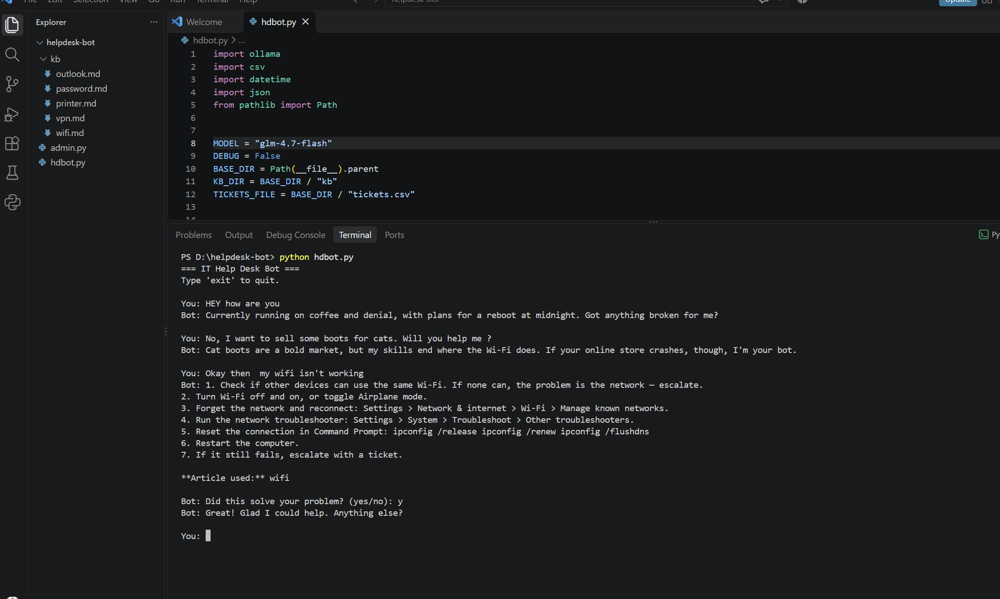
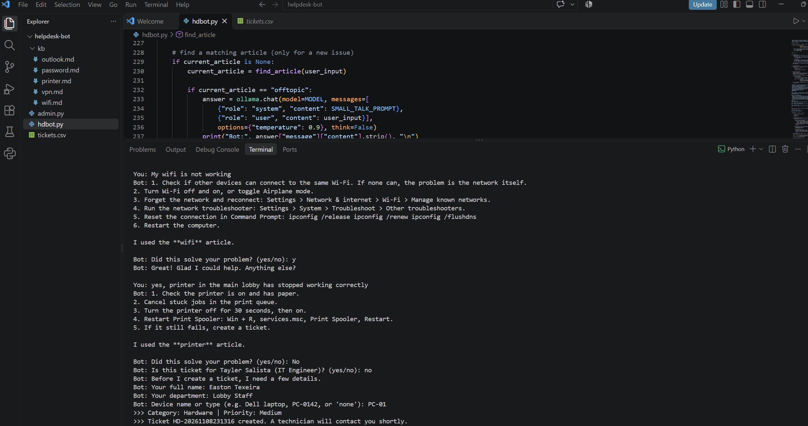
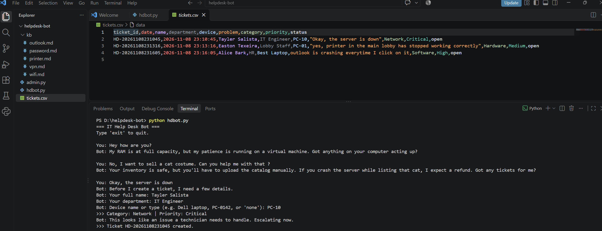
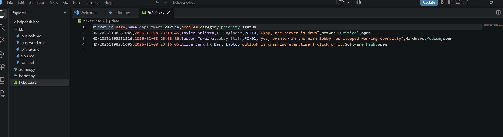

# AI Help Desk Bot

I built this to practice Tier 1 IT support and to learn how to work with a local AI model in Python.
The bot answers common IT problems using a small knowledge base I wrote, and when it can't help,
it opens a ticket. There's also a simple panel where a technician can view and close tickets.

Everything runs on my own laptop with Ollama and the GLM-4.7-Flash model. No cloud, no API keys.

## Demo

Small talk, then a Wi-Fi problem solved from the knowledge base:



The printer steps didn't help, so the bot asks who the ticket is for and opens one:



A server outage has no matching article, so it goes straight to a Critical ticket:



What the saved tickets look like:



## What it does

- Answers only from the articles in the `kb` folder (printer, Wi-Fi, VPN, Outlook, passwords)
- Asks "Did this solve your problem?" after giving steps. If not, it opens a ticket.
- Asks for name, department, and device before creating a ticket
- Uses the AI to pick a category and priority for each ticket
- Never asks for passwords
- Has a bit of personality for off-topic messages, but doesn't open tickets for them
- `admin.py` lets a technician see tickets sorted by priority, filter them, close them, and see basic stats

## How it works

When a message comes in, the bot first asks the model which article fits, or whether the message
isn't about IT at all. Then it asks the model a second time to double-check that the article really
matches. Only after both checks pass does it show the steps. If either check fails, the bot creates
a ticket instead of guessing.

## Running it

1. Install [Ollama](https://ollama.com/download) and download the model:
   ```
   ollama pull glm-4.7-flash
   ```
2. Install the Python library:
   ```
   pip install ollama
   ```
3. Start the bot:
   ```
   python hdbot.py
   ```
4. Open the technician panel:
   ```
   python admin.py
   ```

## Problems I ran into

This was the most useful part of the project.

**The model made things up.** I told it in the prompt to only use my articles, but when I asked
about a flickering monitor (no article for that), it still gave confident troubleshooting steps.
Changing the wording and lowering the temperature didn't fully fix it. What worked was taking the
decision away from the model: the code now checks for a matching article first, and if there isn't
one, the model never gets to answer.

**It opened tickets on its own.** One of my articles ends with "escalate with a ticket," and the
model took that as an instruction and created a ticket right after showing the steps. I removed
ticket decisions from the model completely. Now only the code creates tickets.

**It picked the wrong article.** With only one article, the model matched almost everything to
"printer," including an internet outage. Adding more articles and a second "does this really fit?"
check fixed it. That check also catches office-wide outages, which should go to a technician
instead of getting single-user steps.

**The answers weren't consistent.** The same message sometimes came back as `offtopic`,
`off-topic`, or `OFFTOPIC.`, so I had to make the code more forgiving when reading the answer.

It's not perfect. It's a small model running on a 32 GB laptop, so replies take a few seconds and it still slips sometimes.

## Files

```
helpdesk-bot/
├── hdbot.py      # the chatbot
├── admin.py      # technician panel
├── kb/           # knowledge base articles
├── screenshots/
└── tickets.csv   # created when the first ticket is opened
```

## What I'd add next

- A web interface instead of the terminal
- Connecting it to my Active Directory lab so it can actually unlock accounts and reset passwords
